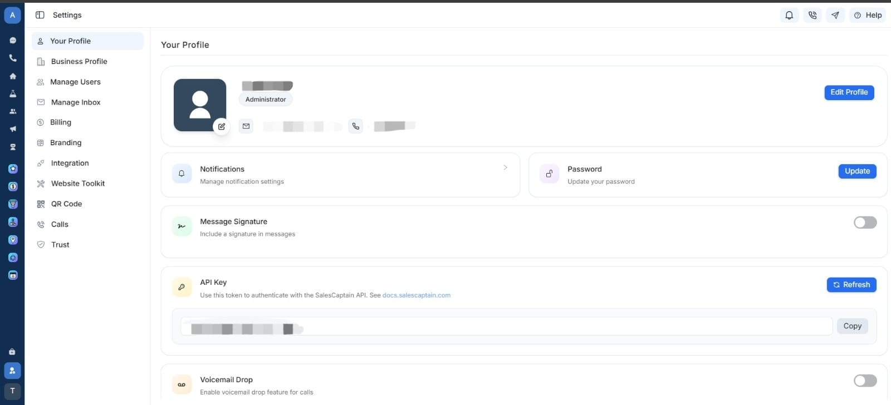

## **How to Use This API**

There are two primary ways to work with the SalesCaptain API:

### 1. OpenAPI Specification

- Use for direct API integration
- Supports tools like Postman, Swagger, and SDK generation

### 2. Interactive Documentation (MDX)

- Embedded examples and UI-based testing
- Ideal for frontend developers and quick testing

---

## Authentication

All API requests require authentication using a Bearer Token.

### Steps:

1. Generate your API key from the **SalesCaptain** [Dashboard](https://app.salescaptain.com/dashboard/settings/your-profile):<br />**Sidebar → Settings → Your Profile → API Key**<br />You can copy your API key from there.
   <Frame>
     
   </Frame>
2. Include the API key in every request header as a Bearer Token.

### Example:

```text
Authorization: Bearer YOUR_API_TOKEN
```

### OpenAPI Security:

```text
"security": [
  {
    "BearerAuth": []
  }
]
```

---

## API Modules

The SalesCaptain API is organized into the following resources:

### Companies

Manage company-level data.

| Method | Endpoint | Description |
| :-- | :-- | :-- |
| GET | `/fetch-companies` | Retrieve all companies |
| GET | `/fetch-company/{company_id}` | Retrieve a company by ID |

---

### Accounts

Access user accounts linked to companies.

| Method | Endpoint | Description |
| :-- | :-- | :-- |
| GET | `/fetch-all-accounts/{company_id}` | Retrieve all accounts by ID |
| GET | `/fetch-account/{account_id}` | Retrieve an account by ID |

---

### Conversation Profiles

Represents communication channels (phone, email, etc.).

| Method | Endpoint | Description |
| :-- | :-- | :-- |
| GET | `/list-conversation-profiles/{company_id}` | List conversation profiles |
| GET | `/list-conversation-profile/{conversation_profile_id}` | Get profile by ID |

---

### Conversations

Manage conversations between contacts and businesses.

| Method | Endpoint | Description |
| :-- | :-- | :-- |
| GET | `/list-conversations/{company_id}` | List conversations |
| GET | `/fetch-conversation/{conversation_id}` | Get conversation by ID |

---

### Messages

Retrieve messages within conversations.

| Method | Endpoint | Description |
| :-- | :-- | :-- |
| GET | `/fetch-message/{message_id}` | Get message by ID |
| POST | `/send-message/{company_id}/{conversation_id}` | Send message by ID |
| GET | `/fetch-messages/{company_id}/{conversation_id}` | List messages |

---

### Contacts

Create, update, and manage contacts.

| Method | Endpoint | Description |
| :-- | :-- | :-- |
| POST | `/create-contact` | Create a contact |
| PUT | `/update-contact/{contact_id}` | Update a contact |
| GET | `/list-contacts/{company_id}` | List contacts |
| GET | `/fetch-contact/{contact_id}` | Get contact by ID |
| DELETE | `/delete-contact/{company_id}/{contact_id}` | Delete a contact |

---

### Custom Fields

Manage structured custom data for contacts.

| Method | Endpoint | Description |
| :-- | :-- | :-- |
| GET | `/list-custom-fields/{company_id}` | List custom fields |
| GET | `/list-custom-field/{custom_field_id}` | Get custom field by ID |

---

### Tags

Create and manage tags and assign them to contacts.

| Method | Endpoint | Description |
| :-- | :-- | :-- |
| GET | `/list-tags/{company_id}` | List tags for a company |
| POST | `/create-tag` | Create a new tag |
| DELETE | `/delete-tag/{company_id}/{tag_id}` | Delete a tag |
| POST | `/add-tag-to-contact/{company_id}` | Add a tag to a contact |
| DELETE | `/remove-tag-from-contact/{company_id}` | Remove a tag from a contact |

---

### Templates

Manage SMS templates.

| Method | Endpoint | Description |
| :-- | :-- | :-- |
| GET | `/sms/list-templates/{company_id}` | List all SMS templates for a company |

---

### Analytics

Retrieve call analytics and reporting data.

| Method | Endpoint | Description |
| :-- | :-- | :-- |
| POST | `/call-analytics` | Fetch call analytics by company |

---