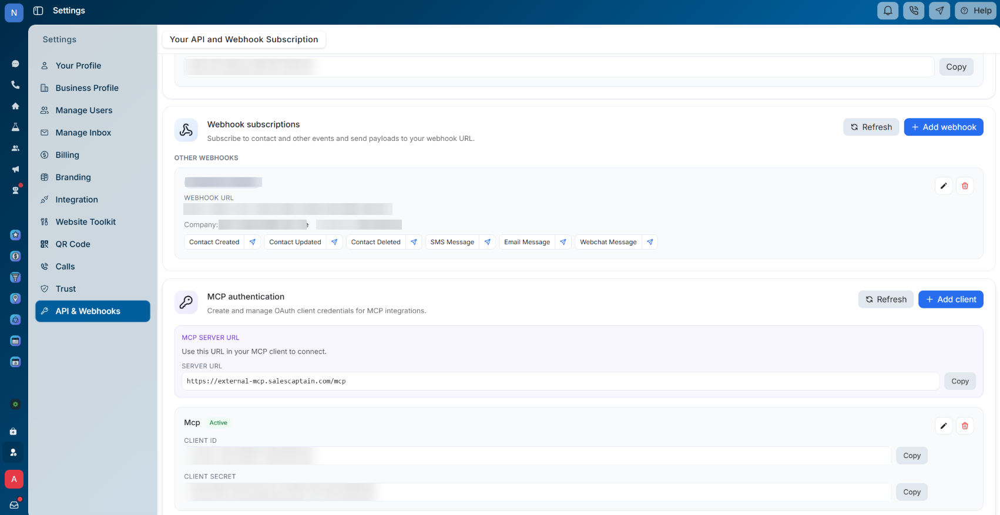
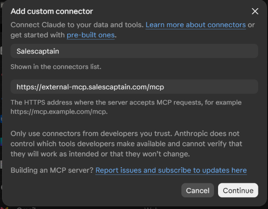
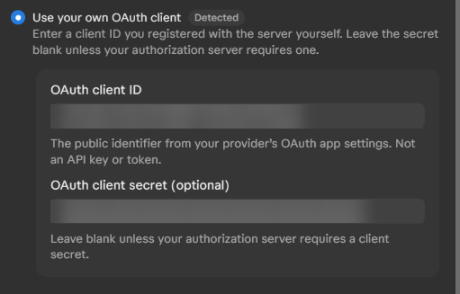
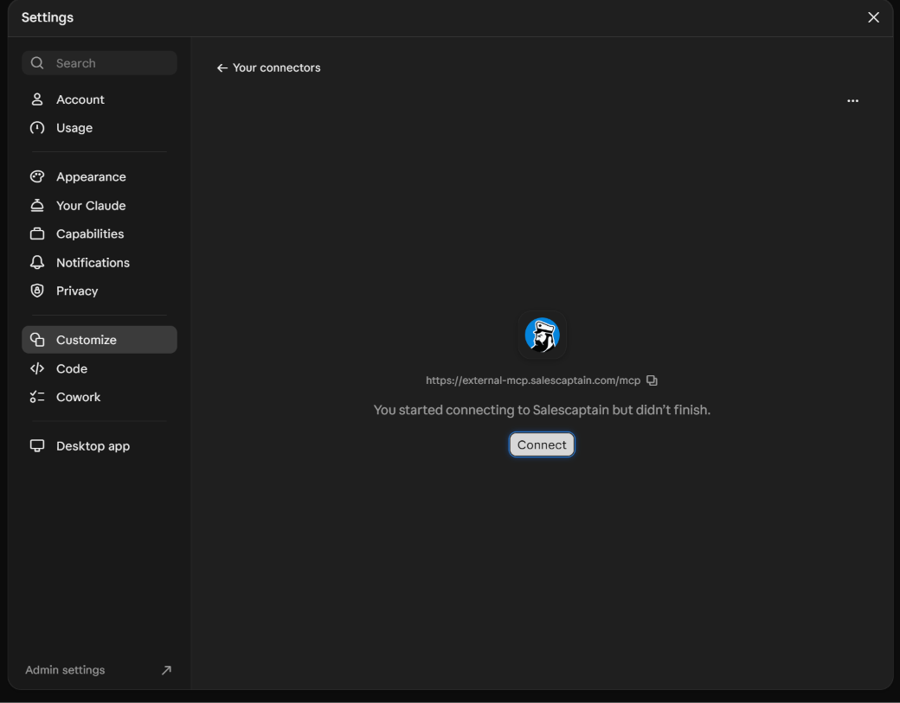
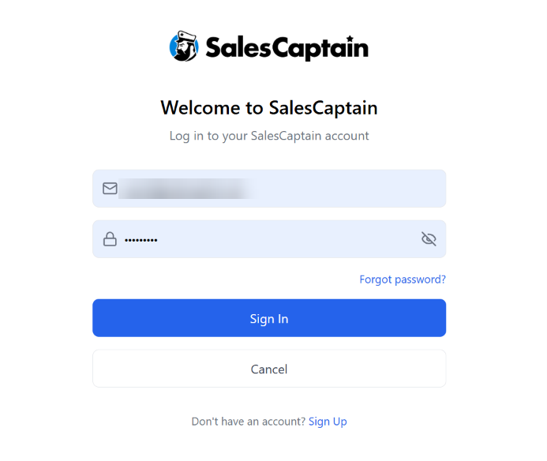
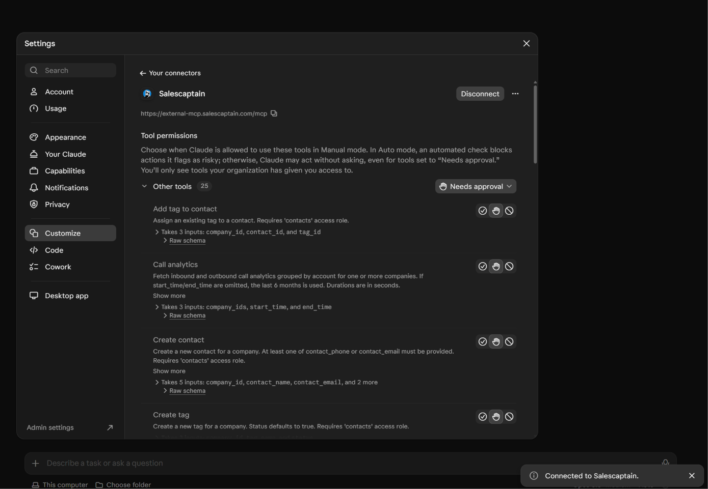

SalesCaptain exposes a remote [Model Context Protocol (MCP)](https://modelcontextprotocol.io) server that lets any compatible AI client manage your calls, contacts, messaging, website leads, payments, reviews, and pipeline stages.

Connect to the SalesCaptain MCP server natively in Claude, Cursor, and other clients, or use [`mcp-remote`](https://www.npmjs.com/package/mcp-remote) for clients that don't yet support remote MCP.

```text
https://external-mcp.salescaptain.com/mcp
```

<Info>
  You'll need a SalesCaptain API key. Get one from **Account Settings > API Keys**. The server handles OAuth automatically — you'll be prompted to sign in and authorize access the first time you connect.
</Info>

## Setup

### Claude

Connecting Claude to SalesCaptain takes about two minutes. You'll need:

- The **Claude** app (desktop or web)
- A **SalesCaptain** account you can log in to

#### Step 1: Create an MCP client in SalesCaptain

1. Open the SalesCaptain app and go to **Settings > API & Webhooks**.
2. Scroll down to **MCP authentication** and click **\+ Add client**.
3. Your new client appears with a **Client ID** and **Client Secret**. Keep this page open, because you'll copy both values in Step 3.

The **MCP Server URL** is shown on the same page:

```text
https://external-mcp.salescaptain.com/mcp
```



> **Keep your Client Secret private.** Don't share it or paste it anywhere except the Claude connector settings.

#### Step 2: Add a custom connector in Claude

1. In Claude, open **Settings > Customize > Connectors**.
2. Click **Add custom connector**.
3. Fill in:
   - **Name:** `Salescaptain`
   - **URL:** `https://external-mcp.salescaptain.com/mcp`
4. Click **Continue**.



#### Step 3: Paste your OAuth client details

1. Select **Use your own OAuth client**.
2. Paste the **Client ID** from SalesCaptain into **OAuth client ID**.
3. Paste the **Client Secret** from SalesCaptain into **OAuth client secret**.
4. Save to create the connector.



#### Step 4: Connect

Open the new **Salescaptain** connector and click **Connect**.



#### Step 5: Log in with SalesCaptain

A SalesCaptain login window opens. Sign in with your SalesCaptain email and password, then click **Sign In**.



#### Step 6: You're connected

Claude returns to the connector page and shows **"Connected to Salescaptain."** The available SalesCaptain tools are listed under **Tool permissions**. Use these settings to choose whether each tool runs automatically, needs your approval, or is blocked.



You can now ask Claude things like _"List my recent contacts in SalesCaptain"_ or _"Show call analytics for last month."_

### ChatGPT

1. Open **Settings > Connectors**
2. Click **Create** (or **Add connector**) and enter the server URL:

```text
https://external-mcp.salescaptain.com/mcp
```

<Info>
  ChatGPT's connectors require the server to support full OAuth 2.1 with dynamic client registration — a plain API key/bearer token is not accepted. Confirm this is supported before advertising ChatGPT compatibility.
</Info>

### Cursor

1. Open Cursor Settings (Cmd/Ctrl + Shift + J)
2. Go to **MCP** and click **Add new MCP server**
3. Select **Type: SSE** and enter the server URL:

```text
https://external-mcp.salescaptain.com/mcp
```

### VS Code (GitHub Copilot)

Add the following to your `.vscode/mcp.json`:

```json
{
  "mcpServers": {
    "salescaptain": {
      "command": "npx",
      "args": ["-y", "mcp-remote", "https://external-mcp.salescaptain.com/mcp"]
    }
  }
}
```

### Windsurf

1. Open Windsurf settings (Cmd/Ctrl + ,)
2. Scroll to **Cascade > MCP servers**
3. Select **Add Server > Add custom server**
4. Add:

```json
{
  "mcpServers": {
    "salescaptain": {
      "command": "npx",
      "args": ["-y", "mcp-remote", "https://external-mcp.salescaptain.com/mcp"]
    }
  }
}
```

### Cline (VS Code extension)

1. Open the Cline panel and click the **MCP Servers** icon
2. Select **Remote Servers > Add Server**
3. Enter a name (`salescaptain`) and the server URL:

```text
https://external-mcp.salescaptain.com/mcp
```

### Claude Code

Run:

```bash
claude mcp add --transport http salescaptain https://external-mcp.salescaptain.com/mcp
```

### Continue

Add the following to your `config.yaml`:

```yaml
mcpServers:
  - name: salescaptain
    type: streamable-http
    url: https://external-mcp.salescaptain.com/mcp
```

<Note>
  Client configuration formats change frequently if a client's MCP settings look different from what's shown here, check that client's own docs for the current syntax.
</Note>

## Need Help?

- Browse our [Knowledge Base](https://docs.salescaptain.com/)
- Reach out to support for setup help
