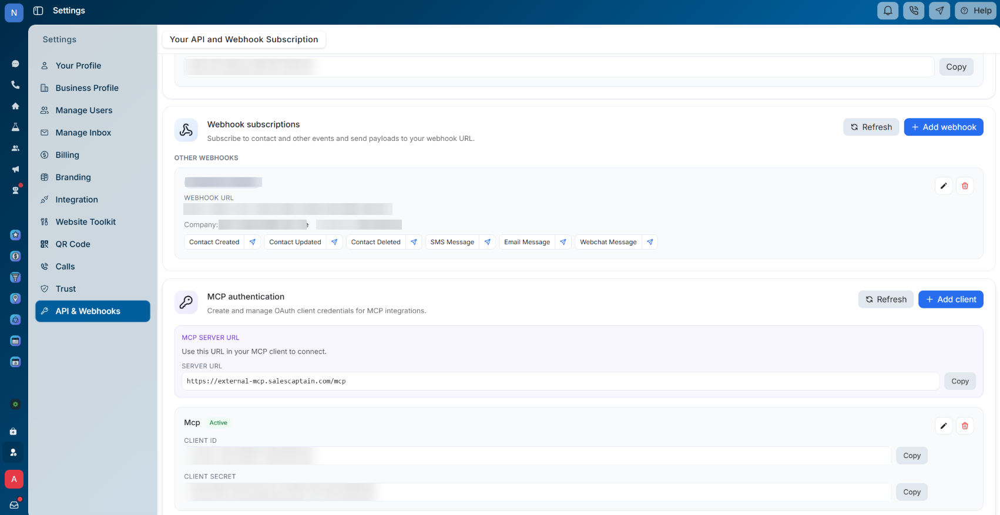
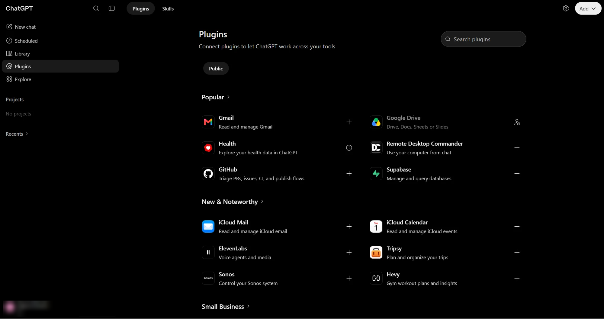
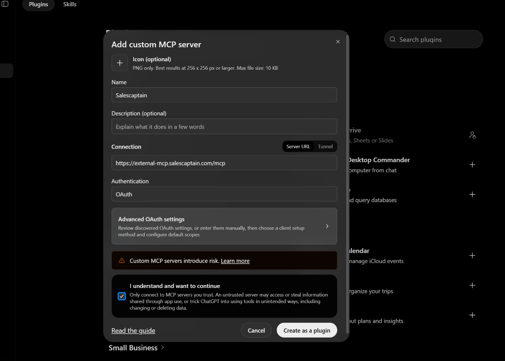
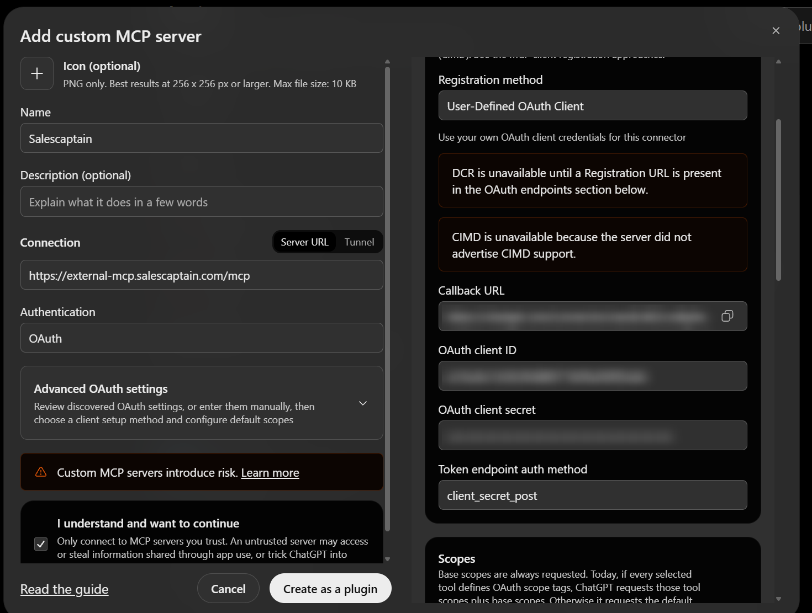
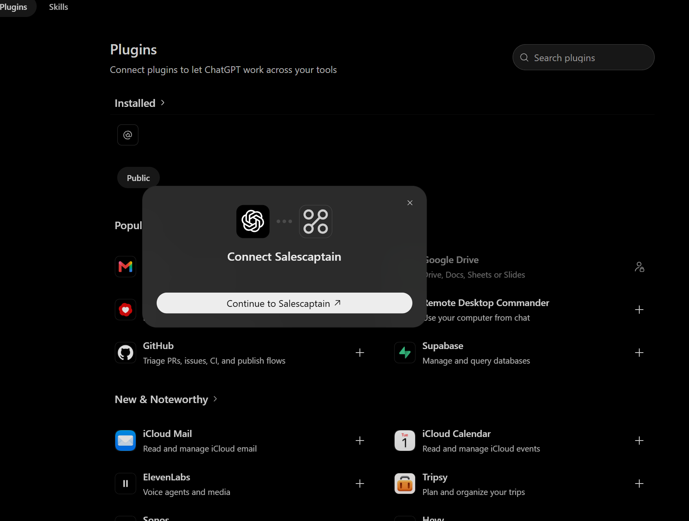
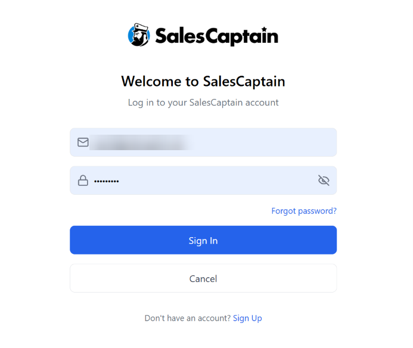
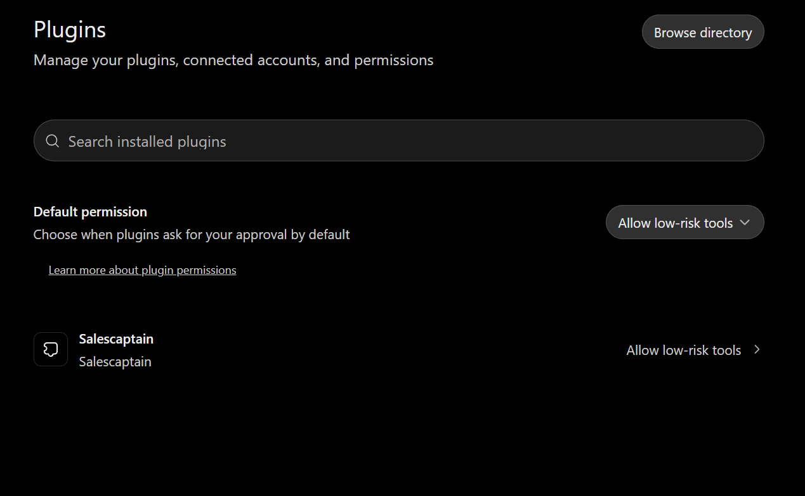

ChatGPT connects to the SalesCaptain MCP server as a custom plugin. Once connected, ChatGPT can look up and act on your SalesCaptain calls, contacts, messaging, website leads, payments, reviews, and pipeline stages.

Setup takes a few minutes. You create an OAuth client in SalesCaptain, add SalesCaptain as a custom MCP server in ChatGPT, then sign in with your SalesCaptain account.

```text
https://external-mcp.salescaptain.com/mcp
```

## Before you begin

You need:

- A **ChatGPT** account
- A **SalesCaptain** account you can log in to
- A **Client ID** and **Client Secret** from SalesCaptain. If you don't have them yet, follow [Create an MCP client](/mcp/create-mcp-client).

## Connect ChatGPT

<Steps>
  <Step title="Copy your client details from SalesCaptain">
    In the SalesCaptain app, go to **Settings > API & Webhooks**. Under **MCP authentication**, copy the **Client ID** and **Client Secret** of your MCP client.

    
  </Step>
  <Step title="Open Plugins in ChatGPT">
    In ChatGPT, click **Plugins** in the sidebar. Then click **Add** in the top-right corner and choose to add a custom MCP server.

    
  </Step>
  <Step title="Enter the server details">
    In the **Add custom MCP server** dialog, fill in:

    - **Name:** `Salescaptain`
    - **Connection:** select **Server URL**, then enter `https://external-mcp.salescaptain.com/mcp`
    - **Authentication:** `OAuth`

    
  </Step>
  <Step title="Paste your OAuth client details">
    1. Click **Advanced OAuth settings**.
    2. Set **Registration method** to **User-Defined OAuth Client**.
    3. Paste the **Client ID** from SalesCaptain into **OAuth client ID**.
    4. Paste the **Client Secret** from SalesCaptain into **OAuth client secret**.

    
  </Step>
  <Step title="Create the plugin">
    Select **I understand and want to continue**, then click **Create as a plugin**.
  </Step>
  <Step title="Connect to SalesCaptain">
    ChatGPT shows **Connect Salescaptain**. Click **Continue to Salescaptain**.

    
  </Step>
  <Step title="Log in with SalesCaptain">
    A SalesCaptain login window opens. Sign in with your SalesCaptain email and password, then click **Sign In**.

    
  </Step>
  <Step title="Check the connection">
    **Salescaptain** now appears in your installed plugins. Use the permission setting next to it to choose when ChatGPT asks for your approval before using SalesCaptain tools.

    
  </Step>
</Steps>

<Warning>
  Only add MCP servers you trust. Keep your Client Secret private and paste it only into ChatGPT's OAuth settings.
</Warning>

## Try it

Ask ChatGPT something like:

- _List my recent contacts in SalesCaptain._
- _Show call analytics for last month._

## Next steps

- See every tool ChatGPT can use in [Available tools](/mcp/Available-Tools).
- Try ready-made prompts in [Examples](/mcp/Examples).
