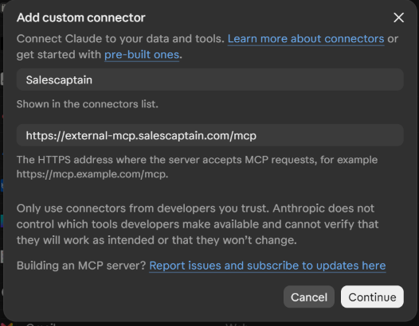
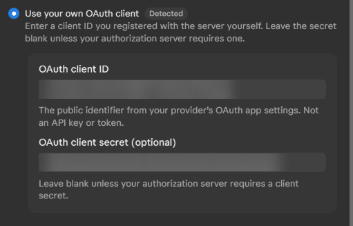
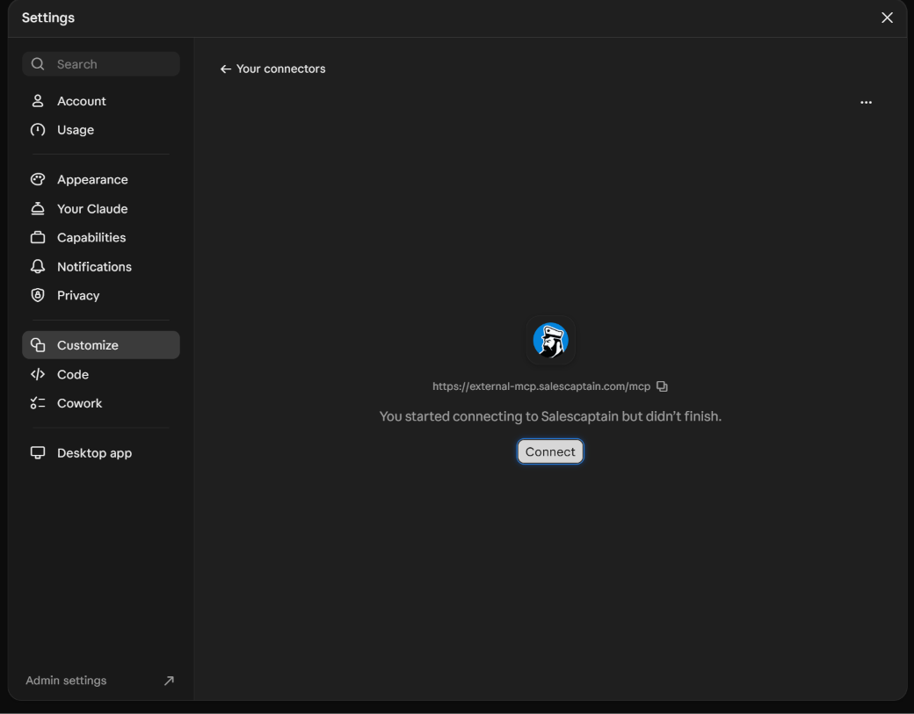
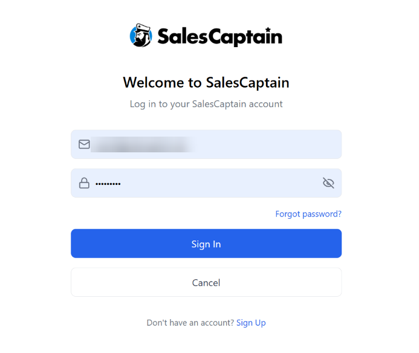
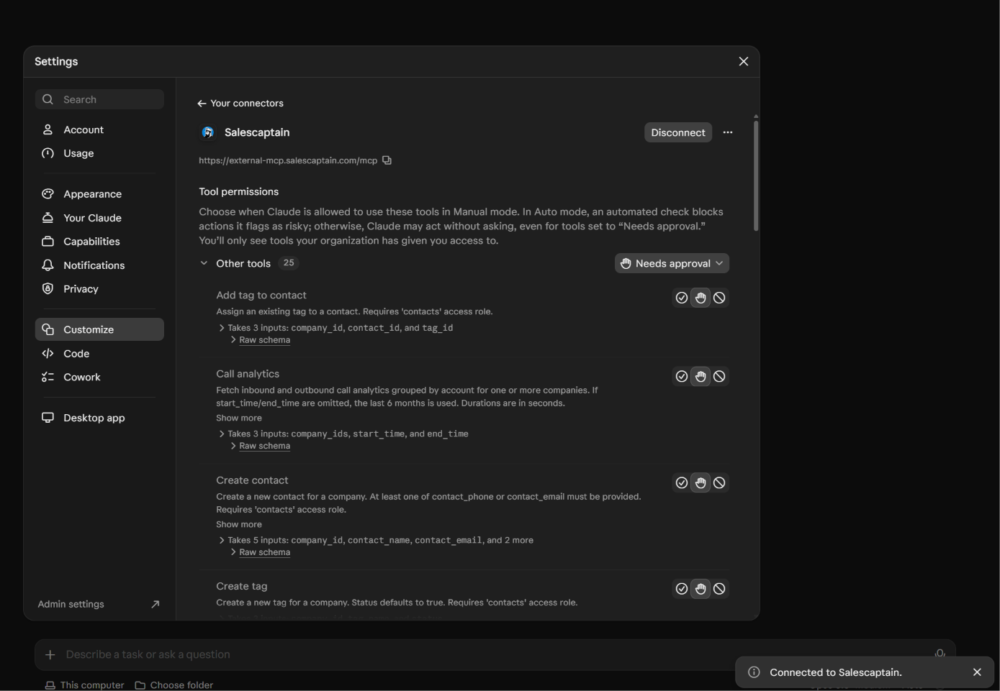

Claude connects to the SalesCaptain MCP server natively through a custom connector. Once connected, Claude can look up and act on your SalesCaptain calls, contacts, messaging, website leads, payments, reviews, and pipeline stages.

Setup takes about two minutes. You create an OAuth client in SalesCaptain, add it to Claude, then sign in with your SalesCaptain account.

```text
https://external-mcp.salescaptain.com/mcp
```

## Before you begin

You need:

- The **Claude** app (desktop or web)
- A **SalesCaptain** account you can log in to
- A **Client ID** and **Client Secret** from SalesCaptain. If you don't have them yet, follow [Create an MCP client](/mcp/create-mcp-client).

## Connect Claude

<Steps>
  <Step title="Add a custom connector">
    1. In Claude, open **Settings > Customize > Connectors**.
    2. Click **Add custom connector**.
    3. Fill in:
       - **Name:** `Salescaptain`
       - **URL:** `https://external-mcp.salescaptain.com/mcp`
    4. Click **Continue**.

    
  </Step>
  <Step title="Paste your OAuth client details">
    1. Select **Use your own OAuth client**.
    2. Paste the **Client ID** from SalesCaptain into **OAuth client ID**.
    3. Paste the **Client Secret** from SalesCaptain into **OAuth client secret**.
    4. Save to create the connector.

    
  </Step>
  <Step title="Connect">
    Open the new **Salescaptain** connector and click **Connect**.

    
  </Step>
  <Step title="Log in with SalesCaptain">
    A SalesCaptain login window opens. Sign in with your SalesCaptain email and password, then click **Sign In**.

    
  </Step>
  <Step title="Check the connection">
    Claude returns to the connector page and shows **Connected to Salescaptain**. The SalesCaptain tools are listed under **Tool permissions**. For each tool, choose whether it runs automatically, needs your approval, or is blocked.

    
  </Step>
</Steps>

## Try it

Ask Claude something like:

- *List my recent contacts in SalesCaptain.*
- *Show call analytics for last month.*

## Next steps

- See every tool Claude can use in [Available tools](/mcp/Available-Tools).
- Try ready-made prompts in [Examples](/mcp/Examples).
