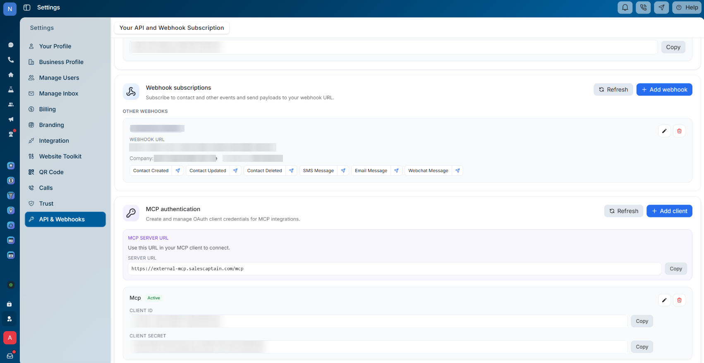

Some AI clients, such as Claude, connect to SalesCaptain through an OAuth client that you create in the SalesCaptain app. The client gives you a **Client ID** and **Client Secret**, which you paste into the AI client's connector settings.

You only need to create a client once. You can reuse it, or create a separate client for each AI tool you connect.

```text
https://external-mcp.salescaptain.com/mcp
```

## Before you begin

You need:

- A **SalesCaptain** account with access to **Settings**

## Create the client

<Steps>
  <Step title="Open API & Webhooks">
    In the SalesCaptain app, go to **Settings > API & Webhooks**.
  </Step>
  <Step title="Add a client">
    Scroll down to **MCP authentication** and click **+ Add client**.
  </Step>
  <Step title="Copy your client details">
    Your new client appears with a **Client ID** and **Client Secret**. Keep this page open while you set up your AI client, so you can copy both values.

    The **MCP server URL** is shown on the same page.

    
  </Step>
</Steps>

<Warning>
  Keep your Client Secret private. Don't share it or paste it anywhere except your AI client's connector settings. If it's exposed, delete the client and create a new one.
</Warning>

## Next steps

- Connect [Claude](/mcp/clients/claude) with your new client details.
- See every supported AI client on the [MCP Server](/mcp/MCP-Server) overview.
